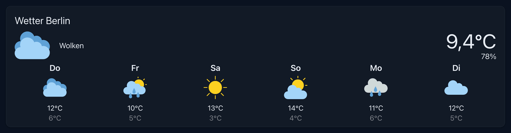

# ioBroker.openweathermap

**This adapter uses Sentry libraries to automatically report exceptions and code errors to the developers.** For more details and for information how to disable the error reporting see [Sentry-Plugin Documentation](https://github.com/ioBroker/plugin-sentry#plugin-sentry)! Sentry reporting is used starting with js-controller 3.0.

Fetches 5 days weather forecast from [https://openweathermap.org/](openweathermap.org)

You need an api key to access the data. The api key you can get for free after registration [here](https://home.openweathermap.org/api_keys).

## vis-2 widget
The widget "Weather" shows the current weather and the forecast for up to six days. The button "i" opens a dialog
with more details (wind, pressure, precipitation). The temperature and the humidity can be taken from a real sensor
instead of OpenWeatherMap (settings "Current temperature ID" and "Current humidity ID").

The size of the icons is set with "Icon size (current)" and "Icon size (days)" in pixels. Empty values keep the
default sizes.

<!--
	### **WORK IN PROGRESS**
-->
## Changelog
### 2.1.0 (2026-10-29)
* (@GermanBluefox) Added settings for the icon size of the current weather and of the forecast days in the vis-2 widget

### 2.0.4 (2026-10-22)
* (@GermanBluefox) Fixed raw translation keys (e.g. openweathermap_Wed) in the widget with vis-2 2.15.x (#750)
* (@GermanBluefox) The widget requires vis-2 2.20.2 or newer, if vis-2 is installed

### 2.0.3 (2026-10-17)
* (@GermanBluefox) Updated packages

### 2.0.2 (2026-10-13)
* (@GermanBluefox) Updated packages
* (@GermanBluefox) Admin 7.6.20+ is required. Fixed the build on CI (missing node types). The API key is protected now. Fixed the schema errors of the configuration

### 2.0.1 (2026-09-08)
* (@GermanBluefox) The weather widget is now shown as a live preview in the admin configuration too

[Older changelogs can be found there](CHANGELOG_OLD.md)

## License

The MIT License (MIT)

Copyright (c) 2018-2026 bluefox <dogafox@gmail.com>

Permission is hereby granted, free of charge, to any person obtaining a copy
of this software and associated documentation files (the "Software"), to deal
in the Software without restriction, including without limitation the rights
to use, copy, modify, merge, publish, distribute, sublicense, and/or sell
copies of the Software, and to permit persons to whom the Software is
furnished to do so, subject to the following conditions:

The above copyright notice and this permission notice shall be included in all
copies or substantial portions of the Software.

THE SOFTWARE IS PROVIDED "AS IS", WITHOUT WARRANTY OF ANY KIND, EXPRESS OR
IMPLIED, INCLUDING BUT NOT LIMITED TO THE WARRANTIES OF MERCHANTABILITY,
FITNESS FOR A PARTICULAR PURPOSE AND NONINFRINGEMENT. IN NO EVENT SHALL THE
AUTHORS OR COPYRIGHT HOLDERS BE LIABLE FOR ANY CLAIM, DAMAGES OR OTHER
LIABILITY, WHETHER IN AN ACTION OF CONTRACT, TORT OR OTHERWISE, ARISING FROM,
OUT OF OR IN CONNECTION WITH THE SOFTWARE OR THE USE OR OTHER DEALINGS IN THE
SOFTWARE.
